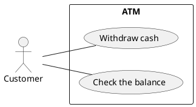
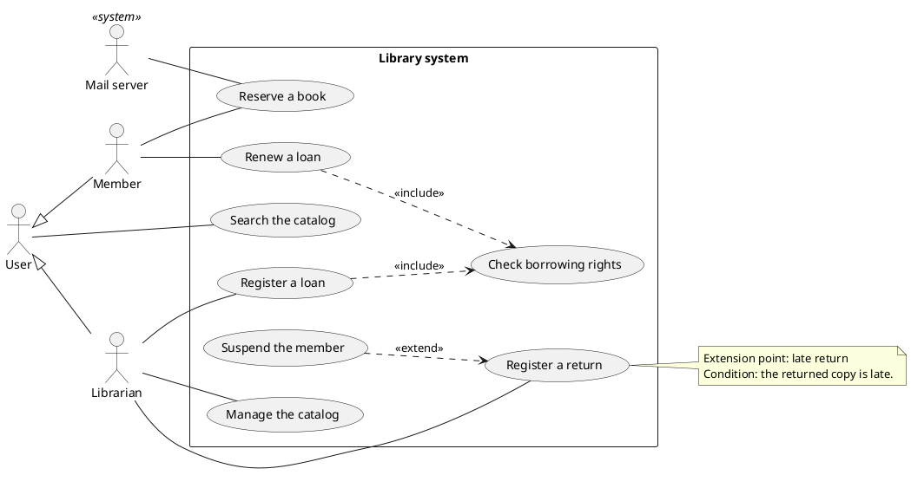
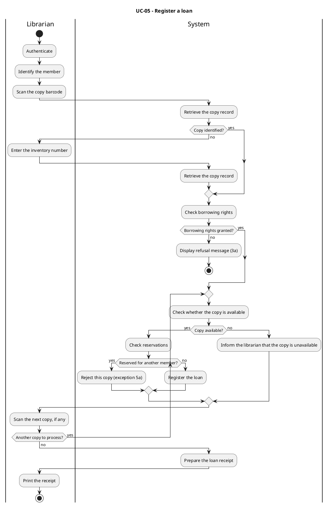
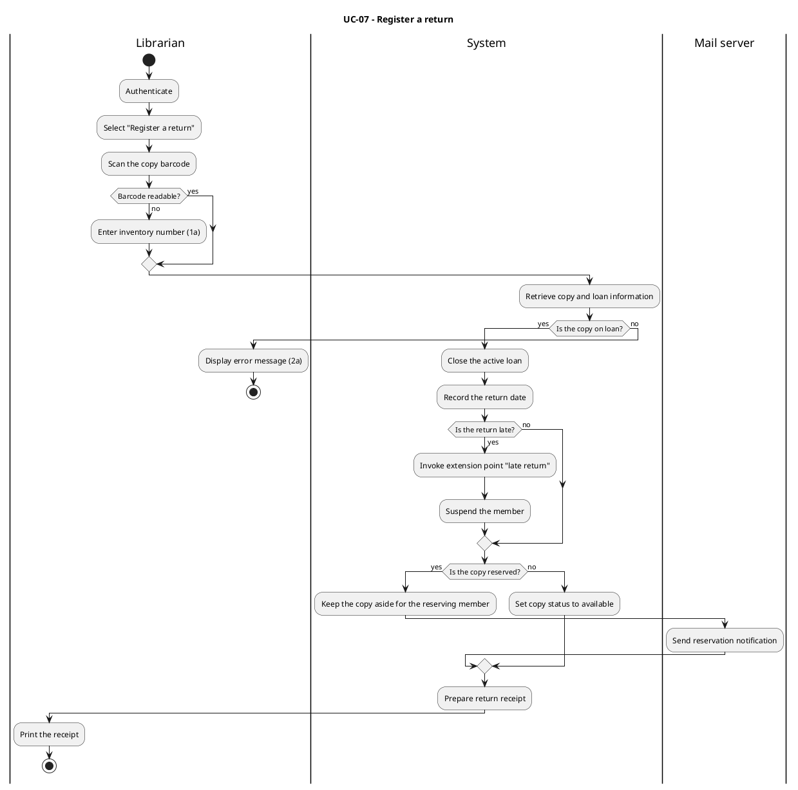

# TP 3 – Complete solutions

This is a consolidated copy of the solution. Individual files ready for VS Code and GitHub are in `docs/uml/`.

## Part A – ATM



## Part B – Library use-case diagram



## Part C – Register a loan activity



## Part D – UC-07 description

# UC-07 – Register a return

## Use-case name
Register a return

## Scope
Library system

## Level
User-goal

## Primary actor
Librarian

## Secondary actor
Mail server

## Stakeholders and interests
- **Member:** wants the returned copy recorded correctly and a receipt issued.
- **Librarian:** wants to register the return and know whether the copy is late or reserved.
- **Library:** wants accurate loan records and correct handling of overdue and reserved copies.
- **Mail server:** sends a notification to the member who reserved the copy.

## Preconditions
- The librarian is authenticated.
- The library system is available.

## Trigger
A member brings a borrowed copy to the librarian and requests to return it.

## Main success scenario
1. The librarian selects **Register a return**.
2. The librarian scans the copy's barcode.
3. The system identifies the copy and retrieves its loan information.
4. The system verifies that the copy is currently on loan.
5. The system closes the active loan and records the return date.
6. The system checks whether the return is late.
7. If the return is late, the system activates the extension point **late return**, invoking **Suspend the member** according to the library rules.
8. The system checks whether the copy has an active reservation.
9. If the copy is reserved, the system keeps it aside for the reserving member.
10. The system asks the Mail server to notify the member who reserved the copy.
11. The system updates the copy status and prepares the return receipt.
12. The librarian selects **Print the receipt**.

## Extensions

### 1a – Barcode cannot be read
At step 2:
1. The librarian enters the inventory number manually.
2. The system searches for the copy using that number.
3. The use case resumes at step 3.

### 2a – Copy is not on loan
At step 4:
1. The system displays an error message explaining that the copy is not currently on loan.
2. The use case ends. No loan is closed and no return receipt is printed.

### Late return – Extension point
At step 6, if the return is late, the system invokes **Suspend the member** through the **late return** extension point. The return process then continues.

### Reserved copy
At step 8, if the copy is reserved, the system keeps it aside for the reserving member and requests notification through the Mail server. Otherwise, the copy is set to available.

## Special requirements
- Preserve the return date and loan history.
- Do not register a return when the copy is not on loan.
- Do not treat a reserved copy as freely available to another member.
- Print a receipt at the end of a successful return.

## Technology and data variations
- The barcode may be read by a scanner, or the inventory number may be entered manually.
- The notification is sent through the Mail server.

## Frequency of occurrence
Whenever a member returns a borrowed copy.

## Part D – Return activity diagram



## Questions (a)–(e)

# TP 3 – Answers to questions (a)–(e)

## (a) Direction and association arrow
`left to right direction` changes the orientation of the automatically generated diagram: PlantUML arranges its elements from left to right instead of using its default layout direction.

In `Customer --> Withdraw`, the arrow indicates a directed relationship in the drawing. It changes the visual notation; it does not mean that the customer sends a message or that the use case is executed in a particular order. The reference notation used in Chapter 3 is an ordinary actor–use-case association, represented as `Customer -- Withdraw`, without an arrowhead.

## (b) Reversed `extend` relationship
PlantUML can render the reversed relationship, but it does not reliably determine that the UML `extend` direction is semantically wrong. A modeling tool can check syntax, recognized notation, and some structural constraints. It cannot determine by itself whether the model accurately represents the real requirements or whether the business meaning and conditions are correct. Those require human review and domain knowledge.

## (c) Two advantages and two drawbacks of PlantUML automatic layout
**Advantages**
1. It saves time because the diagram is arranged automatically without manually positioning every element.
2. The layout can be regenerated after source changes, and the text source is easy to edit.

**Drawbacks**
1. The automatic arrangement may not match the reference layout; lines can cross or elements may be far apart.
2. The user has less precise control over element positions than in a graphical editor, so direction hints and declaration order may be needed.

## (d) PlantUML compared with a graphical tool such as Modelio
- **Editing:** PlantUML is edited as text, which is quick for users comfortable with code and makes changes easy to review. Modelio uses a graphical palette and direct manipulation, which may be easier for beginners.
- **Layout:** PlantUML generates layout automatically and supports direction hints. A graphical tool usually gives more direct control over element placement.
- **Version control:** PlantUML text files work well with Git because changes appear as readable line-by-line diffs. A graphical model may be stored in a format that is harder to compare.
- **Consistency:** PlantUML source files can be kept together and reviewed, but consistency still depends on the author. A graphical modeling tool may provide model-level features and shared elements that help maintain consistency.

## (e) Why keep models in the same repository as the code?
Keeping models in the same repository links the design to the implementation. Developers can review diagrams and code together, track changes in the same Git history, identify which design version belongs to a code version, collaborate through commits and pull requests, and update documentation when the implementation changes. This reduces the risk that diagrams become outdated or separated from the software they describe.

## Part E – Git workflow

```bash
git add docs/uml
git commit -m "Add corrected TP3 UML diagrams and answers"
git push origin main
```

Run `git diff -- docs/uml/use-cases.puml` to inspect readable text changes. After regenerating a PNG, `git diff -- docs/uml/use-cases.png` normally reports a binary-file change rather than a readable line-by-line diff.
